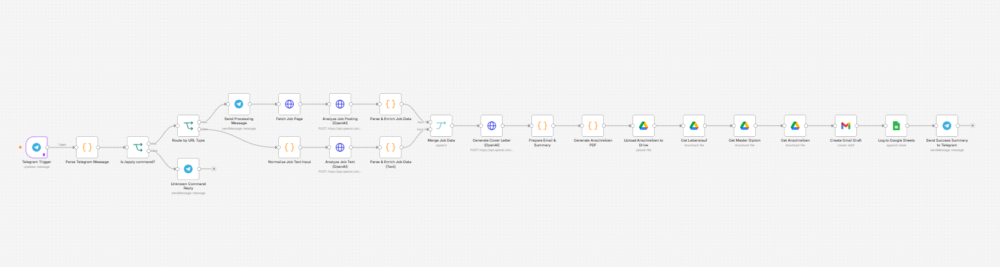
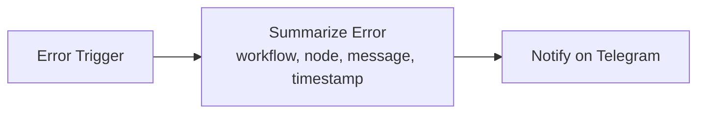

# Bewerbung-Auto — Telegram-driven job application automation with n8n

A low-code automation project that turns a single Telegram message into a complete German job-application package: it fetches or parses a job posting, extracts the relevant data with an LLM, generates a formal German *Anschreiben* (cover letter), renders it as a PDF from scratch in JavaScript, uploads it to Google Drive, assembles a Gmail draft with CV and certificates attached, logs the application in Google Sheets and reports the result back on Telegram. What used to take **30–60 minutes per application** now takes seconds (§1).

> Built and analysed for learning purposes. The workflow was assembled in n8n; parts of the structure were generated with an AI-assisted builder (see *AI assistance disclosure*). All logic described here is derived from the exported workflow JSON.

---

## 1. Problem statement

Applying to jobs in Germany is repetitive and error-prone: every posting has to be read, the cover letter rewritten for each company, PDFs formatted correctly, attachments collected and applications tracked manually. This project automates that pipeline end-to-end from a chat interface.

### The time it saves

A single manual application takes **30–60 minutes**: reading the job description, extracting the relevant information, writing a tailored letter, preparing the CV, sending the e-mail and recording the application in a spreadsheet. With this system the same chain runs in **seconds**, triggered by one Telegram message.

| Step | Manual effort | What the workflow does |
|---|---|---|
| 1. Receive the request | opening a job portal | I send `apply <job URL>` (or paste the job text) on Telegram |
| 2. Retrieve the posting | reading it by hand | the workflow opens the link and reads the posting automatically (Arbeitsagentur REST API, or normalised pasted text) |
| 3. Analyse the job | skimming for details | an LLM extracts company name, job title, location, required skills, contact e-mail and — when available — the hiring manager's name |
| 4. Write the letter | 15–30 minutes of typing | a professional, customized German *Anschreiben* is generated in a formal, persuasive tone based on the requirements and my experience |
| 5. Convert it to PDF | formatting in Word | the letter is laid out as an A4 PDF built from scratch in JavaScript (multi-page aware) |
| 6. Store the files | manual file handling | everything lands in a dedicated Google Drive folder, so every application stays organized |
| 7. Prepare the e-mail | copy/paste + attachments | a Gmail **draft** with subject line, body and three attachments: CV, certificates and the cover letter |
| 8. Track applications | spreadsheet entry | date, job URL and company are appended to Google Sheets |
| 9. Confirm it worked | checking manually | an instant Telegram notification with a summary of the opportunity; failures are reported by the error handler |

**Net effect:** instead of 30–60 minutes per application, the whole preparation takes seconds — faster, more organized and consistently professional. *(The automated chain itself completes in well under a minute; exact wall-clock time depends on OpenAI/Google API latency. The final e-mail is still reviewed and sent by me.)*

### The idea behind the project

An AI-powered assistant that automates the entire job-application *preparation* workflow: it does the repetitive work (reading, extracting, writing, formatting, filing, logging) while the human stays in control of the decision — applications are only drafted, never auto-sent.

If you need to automate repetitive tasks in your daily work or business, the same pattern (chat trigger → fetch → LLM extraction → document generation → storage → draft e-mail → logging → notification) can be adapted to invoices, reminders, reporting bots and more. A ready-to-publish write-up of this project is available in [`docs/linkedin-post.md`](docs/linkedin-post.md).

**Use cases**
- Bulk applications where a candidate sends `apply <url>` or pastes job text on Telegram and receives a ready-to-send draft.
- Learning project for API integration, JSON processing, LLM orchestration and document generation.
- Template for similar automations (e.g. invoice, reminder or reporting bots).

## 2. Key features

| Feature | How it is implemented |
|---|---|
| Chat-based command interface | Telegram trigger + `apply` keyword parsing in a JavaScript Code node |
| Two input modes | Arbeitsagentur URL → official REST API; pasted text → LLM extraction |
| Structured job data | OpenAI chat completions with `response_format: json_object`, temperature 0.1 |
| Defensive parsing | JSON parse with regex fallback if the model returns non-JSON |
| German cover letter | OpenAI generation, temperature 0.7, max 1800 tokens, formal tone constraints |
| PDF generated without external libraries | Hand-written PDF object structure (A4, Helvetica/WinAnsi) in a Code node |
| Document assembly | Google Drive download of CV and certificates, re-download of the generated letter |
| Human-in-the-loop output | Gmail **draft** is created — nothing is sent automatically |
| Audit trail | Application logged to a Google Sheet; confirmation message on Telegram |
| Multi-page PDF | the hand-written generator starts a new page when the bottom margin is reached (no silent truncation) |
| Resilience | `retryOnFail` / `maxTries: 3` / `waitBetweenRetries: 2` on every network node + a separate Error Handler workflow that reports failures to Telegram |
| Config-driven profile | applicant name, address, phone and e-mail come from one `Applicant Profile` node backed by environment variables |

## 3. Architecture overview

This repository contains the application pipeline and its companion error handler.

1. **`Bewerbung My`** (active, 24 nodes) — the application pipeline described below.
2. **`Workflow Error Handler`** (3 nodes) — Error Trigger → error summary → Telegram alert; attach it as the *Error Workflow* of the main pipeline.

The second workflow from the original project, an experimental multimodal RAG assistant (`Answer from vector v2`, 25 nodes), now lives in its own repository: [answer-from-vector-v2](https://github.com/bandarsiri2026/answer-from-vector-v2).

Canvas view of the active pipeline (24 nodes):



### Workflow A — `Bewerbung My` (24 nodes)
```mermaid
flowchart LR
  TG[Telegram Trigger] --> PARSE[Parse Telegram Message<br/>JS: keyword + URL + e-mail regex]
  TG -.-> PROFILE[Applicant Profile<br/>name, address, phone, e-mail from env vars]
  PARSE --> ISAPPLY{Is /apply command?}
  ISAPPLY -- true --> ROUTE{Route by URL Type}
  ISAPPLY -- false --> UNKNOWN[Unknown Command Reply]
  ROUTE -- contains arbeitsagentur.de --> MSG[Send Processing Message]
  ROUTE -- otherwise --> NORM[Normalize Job Text Input]
  MSG --> FETCH[Fetch Job Page<br/>Arbeitsagentur REST API]
  FETCH --> EXTRACT[Analyze Job Posting - OpenAI]
  EXTRACT --> ENRICH[Parse & Enrich Job Data]
  NORM --> EXTRACT2[Analyze Job Text - OpenAI]
  EXTRACT2 --> ENRICH2[Parse & Enrich Job Data (Text)]
  ENRICH --> MERGE[Merge Job Data]
  ENRICH2 --> MERGE
  MERGE --> COVER[Generate Cover Letter - OpenAI]
  COVER --> PREP[Prepare Email & Summary]
  PROFILE -.-> PREP
  PREP --> PDF[Generate Anschreiben PDF<br/>PDF bytes built in JS, multi-page]
  PROFILE -.-> PDF
  PDF --> DRIVE[Upload Anschreiben to Drive]
  DRIVE --> CV[Get Lebenslauf]
  CV --> DIPLOMA[Get Master Diplom]
  DIPLOMA --> ANSCHREIBEN[Get Anschreiben from Drive]
  ANSCHREIBEN --> DRAFT[Create Gmail Draft<br/>3 attachments]
  DRAFT --> SHEET[Log to Google Sheets]
  SHEET --> SUCCESS[Send Success Summary to Telegram]
```

### Error handler — `Workflow Error Handler` (3 nodes)



## 4. Technologies and integrations

| Layer | Technology |
|---|---|
| Automation engine | n8n (workflow export, execution order v1, binary mode separate) |
| Messaging | Telegram Bot API (trigger + send text/audio) |
| E-mail | Gmail (draft creation with attachments) |
| Documents/storage | Google Drive (upload/download), Google Sheets (logging) |
| AI models | OpenAI GPT-4o (extraction and cover letter), GPT-4.1-mini (agent), GPT-4o-mini (image analysis), transcription + text-to-speech |
| External data source | Arbeitsagentur job search REST API (`rest.arbeitsagentur.de`) |
| Custom code | Node.js Code nodes: regex parsing, JSON enrichment, PDF byte generation |

## 5. Installation and import

1. Install n8n (self-hosted via Docker/npm or use n8n Cloud):
   ```bash
   npm install -g n8n
   n8n start
   ```
2. Open the n8n UI → **Workflows** → **Import from file** and select:
   - `workflows/bewerbung-my.sanitized.json` (main pipeline)
   - `workflows/error-handler.sanitized.json` (shared error handler)
3. Do **not** import the raw export if it still contains secrets — use the sanitized versions only.
4. After import, open every node that shows a missing credential and attach your own credentials.
5. Create the referenced Google Drive folder and Sheets, then update the placeholder IDs in the nodes to your own resources.
6. In each workflow's **Settings → Error Workflow**, select the imported error handler so failures are reported on Telegram.
7. Activate the workflow only after all credentials are configured.

## 6. Configuration requirements

| Item | Where it is used | Notes |
|---|---|---|
| Telegram bot token | Telegram trigger + send nodes | The bot must be able to message the user who messages it |
| Google OAuth (Sheets) | logging sheet | needs read/write access to the target sheet |
| Google OAuth (Drive) | upload/download documents | folder must exist and be writable |
| Gmail OAuth | draft creation | drafts are created, not sent |
| OpenAI API key | three HTTP nodes / agent nodes | store as credential or `OPENAI_API_KEY` env var |
| Applicant profile data | `Applicant Profile` node and PDF header | name, address, phone, e-mail read from env vars |

Recommended environment variables (self-hosted n8n):
```bash
OPENAI_API_KEY=...            # never commit this
APPLICANT_NAME=...
APPLICANT_ADDRESS=...
APPLICANT_PHONE=...
YOUR_EMAIL=...                # your own address, used in the PDF header
FALLBACK_EMAIL=...            # used when no contact e-mail is found
TELEGRAM_CHAT_ID=...          # only for the error-handler workflow
```

## 7. Safe credential setup

- Store all tokens in n8n's **Credentials** manager, never inside node parameters.
- For raw HTTP nodes use *Basic/Bearer auth* from a credential instead of a literal header value.
- Scope OAuth grants to the minimum required (Sheets, Drive, Gmail).
- Rotate any key that has ever appeared in an exported file.
- Keep exports out of version control; publish only sanitized versions.

## 8. Example execution

Input on Telegram:
```text
apply https://www.arbeitsagentur.de/jobsuche/jobdetail/XYZ123456
```
Expected behaviour according to the configuration:
1. The Code node detects `apply`, extracts the reference number and base64-encodes it.
2. A status message is sent: "Analysiere die Stellenanzeige...".
3. The job detail JSON is fetched from the Arbeitsagentur API.
4. GPT-4o returns structured fields (company, title, location, description, skills, contact e-mail, hiring manager).
5. A German cover letter body is generated and converted into an A4 PDF named `Anschreiben_<job_title>.pdf`.
6. The PDF is uploaded to the Drive folder; CV and certificates are downloaded.
7. A Gmail draft with subject `Bewerbung als <job title>` and three attachments is created.
8. A row (Name, Date, Link) is appended to the tracking sheet.
9. Telegram receives a confirmation summary with company, position, location and contact e-mail.

If instead the user pastes plain job text (no URL), steps 3–4 use the text branch; the outcome is identical.

## 9. Error handling and troubleshooting

**Currently configured:** defensive parsing inside the Code nodes (`try/catch` around `JSON.parse`, regex fallback for e-mail extraction, default values such as "Unknown Company"), **`retryOnFail: true` / `maxTries: 3` / `waitBetweenRetries: 2` on every HTTP node**, and a companion **Error Handler workflow** (`workflows/error-handler.sanitized.json`) that reports the failing node and message back to Telegram.

Common failure modes observed from the configuration:
| Symptom | Cause | Fix |
|---|---|---|
| HTTP 404 from the job API | URL contained no reference number → empty base64 path | validate `refnr` before calling; fall back to text branch |
| "Unknown Company / Unknown Position" | model returned non-JSON or empty text input | add validation and a Telegram warning instead of continuing |
| Application addressed to the wrong mailbox | fallback e-mail used when no contact found | stop and ask the user for the recipient |
| PDF content cut off | previously the layout stopped writing at `y < 80` | fixed: the generator now paginates; verified by `scripts/pdf_test.js` |
| Workflow does nothing on a message | Switch/If rules do not match (e.g. a PDF attachment) | add a fallback rule |
| Attachment missing in the draft | Drive file ID changed or permission error | verify IDs and OAuth scope |

Remaining improvement: validate extracted job data before generating documents (see §11) and add a fallback branch for unsupported message types such as PDF attachments or stickers.

## 10. Security considerations

- No secrets are stored in the sanitized workflow file; all tokens come from n8n credentials or environment variables.
- The original export contained a plaintext OpenAI key — it has been revoked/rotated before publishing (see `SECURITY_AUDIT.md`).
- Personal data is externalised to configuration rather than hard-coded.
- Applications are only drafted, never auto-sent, which prevents accidental mass mailings.

## 11. Hardening already applied vs. still planned

**Implemented in this repository**
- `retryOnFail` / `maxTries: 3` / `waitBetweenRetries: 2` on every network node (job API, the three OpenAI calls, Drive, Sheets, Gmail and Telegram sends).
- Multi-page PDF generation instead of the original single-page truncation, plus a standalone Node.js test harness (`scripts/pdf_test.js`) that renders `docs/sample-anschreiben.pdf` outside n8n.
- A companion **Error Handler** workflow (`workflows/error-handler.sanitized.json`: Error Trigger → Code summary → Telegram notification).
- Applicant profile moved into its own `Applicant Profile` node instead of hard-coded strings inside the PDF code.
- Dead code removed (the unused `is_yes` / `is_no` flags from the message parser).

**Still planned**
1. Replace raw HTTP calls with n8n's OpenAI nodes and credential-based auth.
2. Add a validation node that rejects incomplete job data before PDF generation.
3. Fallback rule for unsupported message types (PDF attachments, stickers).
4. Scheduled digest of applications from the tracking sheet.
5. Unit tests for the parsing functions extracted into a standalone module.

**Run the PDF test locally**

```bash
node scripts/pdf_test.js   # writes docs/sample-anschreiben.pdf
```

It exercises the same `buildPdf()` logic used by the workflow's Code node, so you can verify layout and pagination without n8n or an API key.

## 12. AI assistance disclosure

This project was developed with AI assistance. The workflow structure and several node configurations were generated with n8n's AI-assisted builder (the export metadata records `aiBuilderAssisted: true`), and analysis/documentation support came from an AI coding assistant. Human work focused on the requirements, prompt design, data-flow decisions, debugging of parsing edge cases, and verification against the exported JSON. No claim is made that every line was written manually.

## 13. License

This project is released under the **MIT License** (see `LICENSE`).


## 14. Repository structure

```text
bewerbung-automation/
├── README.md                     (this file)
├── SECURITY_AUDIT.md             (pre-publication security review of the export)
├── PROJECT_ANALYSIS_AR.md        (detailed Arabic technical analysis, node by node)
├── workflows/
│   ├── bewerbung-my.sanitized.json          (main pipeline, 24 nodes)
│   └── error-handler.sanitized.json         (Error Trigger → Telegram notification)
├── scripts/
│   ├── pdf_test.js                          (standalone test for the PDF generator)
│   └── validate_workflows.py                (secret + connection sanity check, used by CI)
├── .github/workflows/validate.yml           (CI: runs both checks on every push)
├── CHANGELOG.md
├── docs/
│   ├── workflow-a-bewerbung-my.png
│   ├── sample-anschreiben.pdf           (generated by scripts/pdf_test.js, placeholders only)
│   ├── linkedin-post.md                 (ready-to-publish project announcement)
│   └── setup.md
├── .env.example                  (variable names only, never values)
├── .gitignore                    (.env, raw exports, screenshots)
└── LICENSE
```

The RAG assistant is **not part of this repository** — see [answer-from-vector-v2](https://github.com/bandarsiri2026/answer-from-vector-v2) for that workflow, its setup guide and its security audit.

`.gitignore` minimum content:
```text
.env
*.env
node_modules/
*raw*.json
Screenshot*
```

> Keep `INTERVIEW_PREPARATION.md` and the **original** exports out of the public repository — they contain real personal data and resource IDs.
