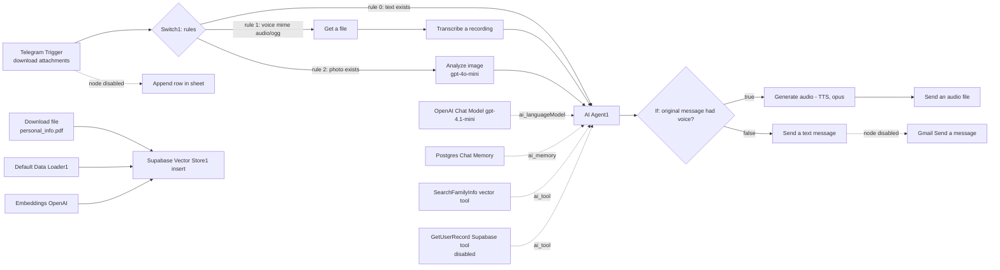

# Bewerbung-Auto — Telegram-driven job application automation with n8n

A low-code automation project that turns a single Telegram message into a complete German job-application package: it fetches or parses a job posting, extracts the relevant data with an LLM, generates a formal German *Anschreiben* (cover letter), renders it as a PDF from scratch in JavaScript, uploads it to Google Drive, assembles a Gmail draft with CV and certificates attached, logs the application in Google Sheets and reports the result back on Telegram.

> Built and analysed for learning purposes. The workflow was assembled in n8n; parts of the structure were generated with an AI-assisted builder (see *AI assistance disclosure*). All logic described here is derived from the exported workflow JSON.

---

## 1. Problem statement

Applying to jobs in Germany is repetitive and error-prone: every posting has to be read, the cover letter rewritten for each company, PDFs formatted correctly, attachments collected and applications tracked manually. This project automates that pipeline end-to-end from a chat interface.

**Use cases**
- Bulk applications where a candidate sends `apply <url>` or pastes job text on Telegram and receives a ready-to-send draft.
- Learning project for API integration, JSON processing, LLM orchestration and document generation.
- Template for similar automations (e.g. invoice, reminder or reporting bots).

## 2. Key features

| Feature | How it is implemented |
|---|---|
| Chat-based command interface | Telegram trigger + `apply` keyword parsing in a JavaScript Code node |
| Two input modes | Arbeitsagentur URL → official REST API; pasted text → LLM extraction |
| Structured job data | OpenAI chat completions with `response_format: json_object`, temperature 0.1 |
| Defensive parsing | JSON parse with regex fallback if the model returns non-JSON |
| German cover letter | OpenAI generation, temperature 0.7, max 1800 tokens, formal tone constraints |
| PDF generated without external libraries | Hand-written PDF object structure (A4, Helvetica/WinAnsi) in a Code node |
| Document assembly | Google Drive download of CV and certificates, re-download of the generated letter |
| Human-in-the-loop output | Gmail **draft** is created — nothing is sent automatically |
| Audit trail | Application logged to a Google Sheet; confirmation message on Telegram |

## 3. Architecture overview

The project contains two independent workflows:

1. **`Bewerbung My`** (active) — the application pipeline described below.
2. **`Answer from vector v2`** (inactive) — an experimental RAG assistant: Telegram text/voice/image → transcription or OCR → AI agent with a Supabase vector store and Postgres chat memory, optionally replying with generated speech. It also contains a manual ingestion branch that loads a PDF into the vector database.

### Workflow A — `Bewerbung My` (23 nodes)
```mermaid
flowchart LR
  TG[Telegram Trigger] --> PARSE[Parse Telegram Message<br/>JS: keyword + URL + e-mail regex]
  PARSE --> ISAPPLY{Is /apply command?}
  ISAPPLY -- true --> ROUTE{Route by URL Type}
  ISAPPLY -- false --> UNKNOWN[Unknown Command Reply]
  ROUTE -- contains arbeitsagentur.de --> MSG[Send Processing Message]
  ROUTE -- otherwise --> NORM[Normalize Job Text Input]
  MSG --> FETCH[Fetch Job Page<br/>Arbeitsagentur REST API]
  FETCH --> EXTRACT[Analyze Job Posting - OpenAI]
  EXTRACT --> ENRICH[Parse & Enrich Job Data]
  NORM --> EXTRACT2[Analyze Job Text - OpenAI]
  EXTRACT2 --> ENRICH2[Parse & Enrich Job Data (Text)]
  ENRICH --> MERGE[Merge Job Data]
  ENRICH2 --> MERGE
  MERGE --> COVER[Generate Cover Letter - OpenAI]
  COVER --> PREP[Prepare Email & Summary]
  PREP --> PDF[Generate Anschreiben PDF<br/>PDF bytes built in JS]
  PDF --> DRIVE[Upload Anschreiben to Drive]
  DRIVE --> CV[Get Lebenslauf]
  CV --> DIPLOMA[Get Master Diplom]
  DIPLOMA --> ANSCHREIBEN[Get Anschreiben from Drive]
  ANSCHREIBEN --> DRAFT[Create Gmail Draft<br/>3 attachments]
  DRAFT --> SHEET[Log to Google Sheets]
  SHEET --> SUCCESS[Send Success Summary to Telegram]
```

### Workflow B — `Answer from vector v2` (25 nodes, inactive)



## 4. Technologies and integrations

| Layer | Technology |
|---|---|
| Automation engine | n8n (workflow export, execution order v1, binary mode separate) |
| Messaging | Telegram Bot API (trigger + send text/audio) |
| E-mail | Gmail (draft creation with attachments) |
| Documents/storage | Google Drive (upload/download), Google Sheets (logging) |
| AI models | OpenAI GPT-4o (extraction and cover letter), GPT-4.1-mini (agent), GPT-4o-mini (image analysis), Whisper-class transcription, text-to-speech |
| Vector database / RAG | Supabase vector store + OpenAI embeddings |
| Conversational memory | Postgres chat memory keyed by Telegram chat ID |
| External data source | Arbeitsagentur job search REST API (`rest.arbeitsagentur.de`) |
| Custom code | Node.js Code nodes: regex parsing, JSON enrichment, PDF byte generation |

## 5. Installation and import

1. Install n8n (self-hosted via Docker/npm or use n8n Cloud):
   ```bash
   npm install -g n8n
   n8n start
   ```
2. Open the n8n UI → **Workflows** → **Import from file** and select the sanitized JSON (`Bewerbung My (2).sanitized.json`).
3. Do **not** import the raw export if it still contains secrets — use the sanitized version.
4. After import, open every node that shows a missing credential and attach your own credentials.
5. Create the referenced Google Drive folder and Sheets, then update the IDs in the nodes to your own resources.
6. Activate the workflow only after all credentials are configured.

## 6. Configuration requirements

| Item | Where it is used | Notes |
|---|---|---|
| Telegram bot token | Telegram trigger + send nodes | The bot must be able to message the user who messages it |
| Google OAuth (Sheets) | logging sheet | needs read/write access to the target sheet |
| Google OAuth (Drive) | upload/download documents | folder must exist and be writable |
| Gmail OAuth | draft creation | drafts are created, not sent |
| OpenAI API key | three HTTP nodes / agent nodes | store as credential or `OPENAI_API_KEY` env var |
| Supabase + Postgres credentials | vector store, chat memory, tool | required only for the RAG workflow |
| Applicant profile data | Code nodes and PDF header | name, address, phone, e-mail — should come from config |

Recommended environment variables (self-hosted n8n):
```bash
OPENAI_API_KEY=...            # never commit this
APPLICANT_NAME=...
APPLICANT_ADDRESS=...
APPLICANT_PHONE=...
APPLICANT_EMAIL=...
```

## 7. Safe credential setup

- Store all tokens in n8n's **Credentials** manager, never inside node parameters.
- For raw HTTP nodes use *Basic/Bearer auth* from a credential instead of a literal header value.
- Scope OAuth grants to the minimum required (Sheets, Drive, Gmail).
- Rotate any key that has ever appeared in an exported file.
- Keep exports out of version control; publish only sanitized versions.

## 8. Example execution

Input on Telegram:
```text
apply https://www.arbeitsagentur.de/jobsuche/jobdetail/XYZ123456
```
Expected behaviour according to the configuration:
1. The Code node detects `apply`, extracts the reference number and base64-encodes it.
2. A status message is sent: "Analysiere die Stellenanzeige...".
3. The job detail JSON is fetched from the Arbeitsagentur API.
4. GPT-4o returns structured fields (company, title, location, description, skills, contact e-mail, hiring manager).
5. A German cover letter body is generated and converted into an A4 PDF named `Anschreiben_<job_title>.pdf`.
6. The PDF is uploaded to the Drive folder; CV and certificates are downloaded.
7. A Gmail draft with subject `Bewerbung als <job title>` and three attachments is created.
8. A row (Name, Date, Link) is appended to the tracking sheet.
9. Telegram receives a confirmation summary with company, position, location and contact e-mail.

If instead the user pastes plain job text (no URL), steps 3–4 use the text branch; the outcome is identical.

## 9. Error handling and troubleshooting

**Currently configured:** only defensive parsing inside the Code nodes (`try/catch` around `JSON.parse`, regex fallback for e-mail extraction, default values such as "Unknown Company"). There are **no retries, no error branches and no error-trigger workflow** in either file.

Common failure modes observed from the configuration:
| Symptom | Cause | Fix |
|---|---|---|
| HTTP 404 from the job API | URL contained no reference number → empty base64 path | validate `refnr` before calling; fall back to text branch |
| "Unknown Company / Unknown Position" | model returned non-JSON or empty text input | add validation and a Telegram warning instead of continuing |
| Application addressed to the wrong mailbox | fallback e-mail used when no contact found | stop and ask the user for the recipient |
| PDF content cut off | single-page layout stops writing at `y < 80` | implement multi-page output or limit letter length |
| Workflow does nothing on a message | Switch/If rules do not match (e.g. a PDF attachment) | add a fallback rule |
| Attachment missing in the draft | Drive file ID changed or permission error | verify IDs and OAuth scope |

Recommended improvements: enable `retryOnFail` on HTTP nodes, add an Error Trigger workflow that notifies Telegram, and validate extracted data before generating documents.

## 10. Security considerations

- No secrets are stored in the sanitized workflow file; all tokens come from n8n credentials or environment variables.
- The original export contained a plaintext OpenAI key — it has been revoked/rotated before publishing (see `SECURITY_AUDIT.md`).
- Personal data is externalised to configuration rather than hard-coded.
- Applications are only drafted, never auto-sent, which prevents accidental mass mailings.

## 11. Current limitations and future improvements

**Limitations present in the workflow as exported**
- Only Arbeitsagentur URLs are fetched; other portals fall back to pasted text.
- Single-page PDF only; long letters are silently truncated.
- No retry or error notification path.
- The RAG workflow is inactive and its ingestion branch is not connected to a trigger (manual run only); three of its nodes are disabled.
- Some parsed flags (`yes`/`no`) are computed but never used — dead code.

**Planned improvements**
1. Replace raw HTTP calls with n8n's OpenAI nodes and credential-based auth.
2. Add a validation node that rejects incomplete job data before PDF generation.
3. Multi-page PDF support or HTML→PDF rendering.
4. Error handling: `retryOnFail`, error branches, Telegram failure notifications.
5. Config-driven applicant profile (Google Sheet or env vars) instead of hard-coded strings.
6. Unit-testable pure functions for parsing and PDF layout.
7. Scheduled digest of applications from the tracking sheet.

## 12. AI assistance disclosure

This project was developed with AI assistance. The workflow structure and several node configurations were generated with n8n's AI-assisted builder (the export metadata records `aiBuilderAssisted: true`), and analysis/documentation support came from an AI coding assistant. Human work focused on the requirements, prompt design, data-flow decisions, debugging of parsing edge cases, and verification against the exported JSON. No claim is made that every line was written manually.

## 13. License

Add a license before publishing (e.g. MIT) if you want others to reuse it.

## 14. Suggested repository structure

```text
bewerbung-automation/
├── README.md                     (this file, adapted)
├── SECURITY_AUDIT.md
├── PROJECT_ANALYSIS_AR.md        (detailed Arabic technical analysis)
├── INTERVIEW_PREPARATION.md      (optional — keep private)
├── workflows/
│   ├── bewerbung-my.sanitized.json
│   └── answer-from-vector-v2.sanitized.json
├── docs/
│   ├── architecture.png          (clean screenshot, no open node panels)
│   └── setup.md
├── .env.example                  (variable names only, never values)
└── .gitignore                    (.env, *.local.json, raw exports)
```

`.gitignore` minimum content:
```text
.env
*.env
node_modules/
*raw*.json
Screenshot*
```

> Keep `INTERVIEW_PREPARATION.md` and the **original** exports out of the public repository — they contain real personal data and resource IDs.
